  

  

  <a href="#sobre-mim">Sobre mim</a> &nbsp; · &nbsp;
  <a href="#tecnologias">Tecnologias</a> &nbsp; · &nbsp;
  <a href="#projetos">Projetos</a>

### Sobre mim

Sou **Sebastiao Neto**, mas pode chamar de **Neto**. Curso **Engenharia de Software** e estou no **2º período**.

Por aqui compartilho meus estudos em **Java, Python e desenvolvimento web**, além dos projetos da faculdade. Um deles é o **Maceió Náutica**, que desenvolvi em equipe.

Ainda tenho bastante coisa para aprender. Este perfil vai acompanhando o caminho.

---

### Tecnologias

**Programação**

 

**Desenvolvimento web**

   

**Banco de dados · usado no Maceió Náutica**

Tecnologias que fazem parte dos meus estudos e projetos.

---

### Projetos

#### ⛵ [Maceió Náutica](https://github.com/Oten7/site-nautico)
**Projeto acadêmico em equipe**

Catálogo de passeios náuticos com busca e filtros, painel de administração e dados salvos em SQLite. A interface web se conecta a um servidor Python.

Python · JavaScript · HTML · CSS · SQLite

[Ver código e instruções de execução ↗](https://github.com/Oten7/site-nautico#readme)

 

#### ☕ [Estudos em Java](https://github.com/Oten7/java)
**Prática de programação**

Repositório com meus estudos em Java durante a graduação.

Java

[Explorar os arquivos ↗](https://github.com/Oten7/java)

#### 📚 [Atividades da faculdade](https://github.com/Oten7/Universidade)
**Exercícios por aula**

Práticas de lógica de programação em Python e C, organizadas por disciplina e aula.

[Consultar o guia das pastas ↗](https://github.com/Oten7/Universidade#readme)

  <a href="https://github.com/Oten7?tab=repositories">Ver todos os repositórios →</a>

---

  <strong>Sebastiao Neto</strong> · Entre uma aula e outra, um commit.

