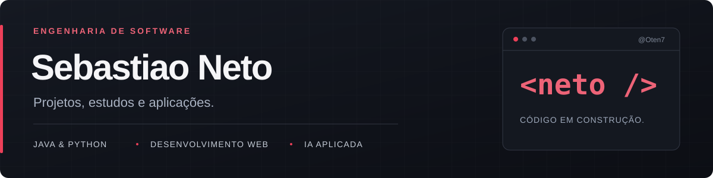

  

  <a href="#projetos-em-destaque">Projetos</a> ·
  <a href="#tecnologias-em-contexto">Tecnologias</a> ·
  <a href="#estudos-e-prática">Estudos</a>

## Olá, sou o Neto.

Sou **Sebastiao Neto**, graduando em **Engenharia de Software**. Estudo **Java, Python e desenvolvimento web** e uso projetos para colocar o aprendizado em prática.

Tenho interesse em aplicações com interfaces claras, dados persistentes e integração com IA. Por aqui, compartilho projetos acadêmicos em equipe, aplicações pessoais e exercícios da graduação.

## Projetos em destaque

### [Crônicas de Aether](https://github.com/Oten7/cronicas-de-aether)

**RPG de fantasia com Mestre IA · Aplicativo Windows disponível**

Criação de personagem, narrativa com Gemini, dados D20, combate e progressão. A edição Windows tem janela própria, partidas solo, salvamento local e backup das campanhas.

**No projeto:** React · JavaScript · Electron · SQLite · API Gemini

[Explorar o projeto →](https://github.com/Oten7/cronicas-de-aether#readme) &nbsp; [Baixar para Windows →](https://github.com/Oten7/cronicas-de-aether/releases/tag/v1.0.0-windows)

O Mestre IA precisa de internet e de uma chave Gemini do jogador. Os saves do aplicativo ficam no computador; não há sincronização com as campanhas do site.

### [Maceió Náutica](https://github.com/Oten7/site-nautico)

**Projeto acadêmico em equipe · Catálogo de passeios náuticos**

MVP com busca, filtros, favoritos, painel administrativo e persistência em SQLite. A interface web se conecta a um servidor Python.

**No projeto:** Python · JavaScript · HTML · CSS · SQLite

[Código e execução local →](https://github.com/Oten7/site-nautico#readme) &nbsp; [Ver a demonstração visual →](https://oten7.github.io/site-nautico/)

Projeto de demonstração acadêmica. A versão no GitHub Pages é estática; as funções de servidor são executadas localmente.

## Tecnologias em contexto

| Área | Estudos e aplicação |
| :--- | :--- |
| Fundamentos | Java e Python em exercícios de lógica e programação. |
| Desenvolvimento web | HTML, CSS e JavaScript nas interfaces dos projetos. |
| Aplicações | React e Electron na edição desktop do Crônicas de Aether. |
| Persistência | SQLite no Maceió Náutica e nos saves locais do RPG. |
| IA aplicada | Integração com a API Gemini para a narrativa do Mestre. |

## Estudos e prática

- **[Java](https://github.com/Oten7/java)** — fundamentos, exercícios e modelagem de classes.
- **[Universidade](https://github.com/Oten7/Universidade)** — atividades de lógica e programação em Python e C.
- **[Estudos em Python](https://github.com/Oten7/udemy)** — exercícios organizados durante os cursos.

---

  <a href="https://github.com/Oten7?tab=repositories">Explorar todos os repositórios</a> 
  Aprendendo com projetos, documentando o processo e evoluindo a cada entrega.

