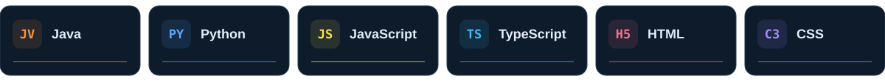

  

  <strong>Engenharia de Software · 2º período</strong> 
  Aprendendo na faculdade. Colocando em prática no código.

  <a href="#sobre-mim">Sobre mim</a> &nbsp; / &nbsp;
  <a href="#minha-jornada">Minha jornada</a> &nbsp; / &nbsp;
  <a href="#tecnologias">Tecnologias</a> &nbsp; / &nbsp;
  <a href="#projetos">Projetos</a>

 

## Sobre mim

Olá! Sou **Sebastiao Neto**, estudante de **Engenharia de Software**, atualmente no **2º período**.

Estou construindo minha base em programação com **Java, Python e tecnologias web**. Este perfil reúne meus estudos, exercícios e projetos — um registro do que estou aprendendo e colocando em prática durante a graduação.

Entre meus trabalhos está o **Maceió Náutica**, projeto acadêmico desenvolvido em equipe que conecta uma interface web a um servidor Python e um banco de dados SQLite.

 

## Minha jornada

| Formação | Na prática |
| :--- | :--- |
| 🎓 Engenharia de Software · **2º período** | Exercícios, estudos e projetos acadêmicos |
| ☕ **Java e Python** | Prática de programação e desenvolvimento de aplicações |
| 🌐 **HTML, CSS, JavaScript e TypeScript** | Estudos em desenvolvimento web |
| 🤝 **Projeto em equipe** | Desenvolvimento do Maceió Náutica |

 

## Tecnologias

  

  Tecnologias que uso ou estudo durante minha formação.

 

## Projetos

<table>
<tr>
<td width="50%" valign="top">
<h3>01 / Maceió Náutica</h3>

<strong>Projeto acadêmico · Em equipe</strong>

Catálogo de passeios náuticos com busca, filtros e painel de administração. Integra interface web, servidor Python e persistência em SQLite.

<code>Python</code> <code>JavaScript</code> <code>HTML</code> <code>CSS</code> <code>SQLite</code>

<a href="https://github.com/Oten7/site-nautico"><strong>Conhecer o projeto ↗</strong></a>

</td>
<td width="50%" valign="top">
<h3>02 / Estudos em Java</h3>

<strong>Prática de programação · Aprendizado</strong>

Meu espaço para praticar Java e registrar os estudos em código enquanto construo minha base em desenvolvimento de software.

<code>Java</code>

<a href="https://github.com/Oten7/java"><strong>Explorar os estudos ↗</strong></a>

</td>
</tr>
</table>

  <a href="https://github.com/Oten7?tab=repositories">Explorar todos os repositórios →</a>

 

---

  <strong>Aprender. Construir. Evoluir.</strong> 
  Sebastiao Neto · Engenharia de Software

